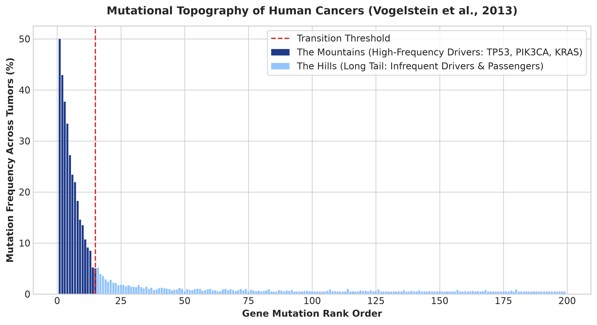

<!-- =====================================================
     HERO SECTION
===================================================== -->
<section class="blog-hero">
    

        Cancer Genomics • Molecular Pathology • Landmark Literature
    

    <h1>Deciphering the Cancer Genome: Mountains, Hills, and the Architecture of Tumors</h1>
    

        An exhaustive exploration into somatic mutations, driver genes, oncogenic pathways, 
        and mutational topography, anchored in the landmark findings of Vogelstein et al. (2013) and Garraway & Lander (2013).
    

</section>

<!-- =====================================================
     METRICS GRID
===================================================== -->

    

        33–66
        Somatic Mutations
        Average per typical adult solid tumor
    

    

        ~140
        Driver Genes
        Cataloged causal genes across human cancers
    

    

        2 to 8
        Drivers per Tumor
        Core mutations required for clonal selection
    

    

        12
        Signaling Pathways
        Regulating cell fate, survival, and genome maintenance
    

# Introduction: The Sequencing Revolution in Oncology

Over the past two decades, high-throughput next-generation sequencing (NGS) has transformed cancer research from empirical pathology into an exact molecular science. Instead of classifying tumors solely by organ histology, modern oncology reads them at single-base resolution. 

Two landmark publications serve as the foundational pillars of this era: Bert Vogelstein and colleagues' 2013 review *"Cancer Genome Landscapes"* published in *Science*, and Levi Garraway and Eric Lander's companion landmark *"Lessons from the Cancer Genome"* published in *Cell*. Together, these works established how tumors initiate, evolve through clonal selection, and evade therapy.

---

# Essential Technical Terminology

Before examining the architectural landscape of tumors, we must define core genomic terms:

* **Single Nucleotide Polymorphisms (SNPs):** Germline DNA sequence variations present in more than 1% of a human population. While SNPs account for normal phenotypic diversity and can modulate inherited disease risk, they are distinct from somatic mutations acquired during oncogenesis.
* **Somatic Mutations:** Genetic alterations acquired in non-germline tissues throughout an individual's lifetime. In oncology, these are the mutations accumulated within tumor cell lineages.
* **Driver Genes:** Genes harboring mutations that confer a selective growth advantage to the cell, actively driving tumorigenesis and clonal expansion.
* **Passenger Mutations:** Neutral genetic alterations that hitchhike alongside driver mutations during clonal expansion without conferring any direct growth advantage.
* **Oncogenes:** Genes that, when activated or overexpressed via gain-of-function mutations (such as point mutations, amplifications, or chromosomal translocations), promote excessive cell proliferation and survival.
* **Tumor Suppressor Genes:** Regulatory genes that normally inhibit cell division or promote DNA repair; both alleles typically must be inactivated (the "two-hit hypothesis") to spark oncogenic transformation.

---

# The Mutational Landscape: Mountains vs. Hills

When looking across thousands of sequenced tumor genomes, Vogelstein et al. demonstrated that somatic mutations are not distributed randomly. Instead, the mutational terrain resembles a distinct geographical topography:

1. **The Mountains:** A small cadre of heavily mutated, well-characterized genes found at high frequencies across diverse tumor types (e.g., *TP53*, *PIK3CA*, *KRAS*, *APC*). These are easily detected even in modest sample cohorts.
2. **The Hills:** A vast expanse of genes mutated at low frequencies (in only 1% to 5% of tumors). Discerning true low-frequency drivers from background passenger noise within these "hills" requires sequencing massive tumor cohorts.

    <picture>
        <source srcset="/notebooks/fig1_mountains_hills_topography.png" type="image/webp">
        
    </picture>
    

        <strong>Figure 1 — The Mountains and Hills of Cancer Genomes.</strong> 
        Schematic representation illustrating the heavy recurrence of "mountain" driver genes versus the long tail of low-frequency "hill" driver genes across tumor cohorts.
    

    <strong>The Driver-to-Passenger Rule:</strong> In a typical adult solid tumor ($e.g.$, colorectal, breast, or pancreatic adenocarcinoma), sequencing reveals between 33 and 66 subtle somatic mutations. However, out of these dozens of changes, only **2 to 8 function as true drivers**; the remainder are inert passengers.

---

# Biological Insights: Pathways over Individual Genes

As Garraway and Lander highlighted in *Cell*, one of the most profound takeaways from cancer genomics is that while individual tumors display high genetic heterogeneity, the biological pathways they hijack are remarkably constrained.

Across the ~140 established driver genes, alterations converge into just **12 core cellular signaling pathways**. These pathways govern three overarching physiological processes:
* **Cell Fate:** Directing whether a cell undergoes mitosis, terminal differentiation, or apoptosis.
* **Cell Survival:** Managing nutrient stress, hypoxia evasion, and inhibiting programmed cell death.
* **Genome Maintenance:** Controlling DNA mismatch repair, homologous recombination, and chromosomal segregation.

When mutations compromise genome maintenance, cells experience an exponential spike in mutation rates (mutator phenotype), supercharging tumor evolution and drug resistance.

---

# Summary Comparison: Drivers vs. Passengers

<table class="research-table">
<thead>
<tr>
  <th>Feature / Attribute</th>
  <th>Driver Mutations</th>
  <th>Passenger Mutations</th>
</tr>
</thead>
<tbody>
<tr>
  <td><strong>Selection Advantage</strong></td>
  <td>Confers a direct growth and survival advantage to clones.</td>
  <td>Neutral; provides no selective growth advantage.</td>
</tr>
<tr>
  <td><strong>Frequency per Tumor</strong></td>
  <td>Typically 2 to 8 per tumor.</td>
  <td>Comprises the majority of the 33–66 somatic mutations.</td>
</tr>
<tr>
  <td><strong>Mutational Signature</strong></td>
  <td>Recurrent hotspots (missense mutations, amplifications, deletions).</td>
  <td>Randomly distributed background noise.</td>
</tr>
<tr>
  <td><strong>Therapeutic Relevance</strong></td>
  <td>Primary targets for precision oncology drugs ($e.g.$, kinase inhibitors).</td>
  <td>Ignored in targeted therapeutic design.</td>
</tr>
</tbody>
</table>

---

# Conclusion and Future Horizons

Genomic sequencing has permanently elevated oncology from empirical observation to molecular engineering. As mapped out by Vogelstein et al. (2013) and Garraway & Lander (2013), understanding the difference between mountains and hills, drivers and passengers, and oncogenes and tumor suppressors is foundational. Future breakthroughs will rely on dynamic liquid biopsies, single-cell multi-omics, and rational combination therapies designed to checkmate tumor evolution.

    <h2>Core Takeaway</h2>
    

        Genomic sequencing reveals that human cancers are driven by a sparse set of causal alterations converging on restricted cellular pathways. Decoupling true driver mechanisms from passenger noise is the bedrock of modern precision oncology.
    

---

<h3>Primary References & Literature</h3>
<ul>
  <li>
    <strong>Cancer Genome Landscapes (Vogelstein et al., 2013):</strong> 
    Vogelstein, B., Papadopoulos, N., Velculescu, V. E., Zhou, S., Diaz, L. A., & Kinzler, K. W. (2013). "Cancer genome landscapes." <em>Science</em>, 339(6127), 1546–1558. 
    <a href="https://doi.org/10.1126/science.1235122" target="_blank" rel="noopener">DOI: 10.1126/science.1235122</a>
  </li>
  <li>
    <strong>Lessons from the Cancer Genome (Garraway & Lander, 2013):</strong> 
    Garraway, L. A., & Lander, E. S. (2013). "Lessons from the cancer genome." <em>Cell</em>, 153(1), 17–37. 
    <a href="https://www.cell.com/cell/fulltext/S0092-8674(13)00288-2" target="_blank" rel="noopener">Cell Full Text Article</a>
  </li>
  <li>
    <strong>National Human Genome Research Institute (NHGRI):</strong> 
    <a href="https://www.genome.gov/" target="_blank" rel="noopener">NHGRI Educational Resources on Cancer Genomics</a>
  </li>
</ul>

