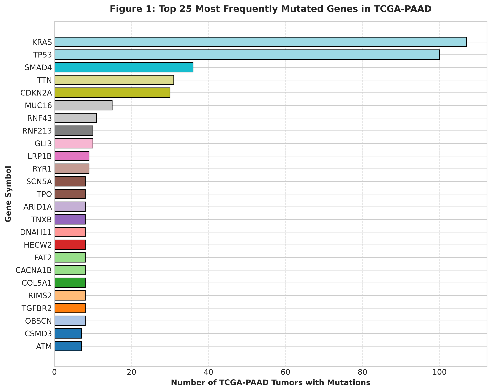
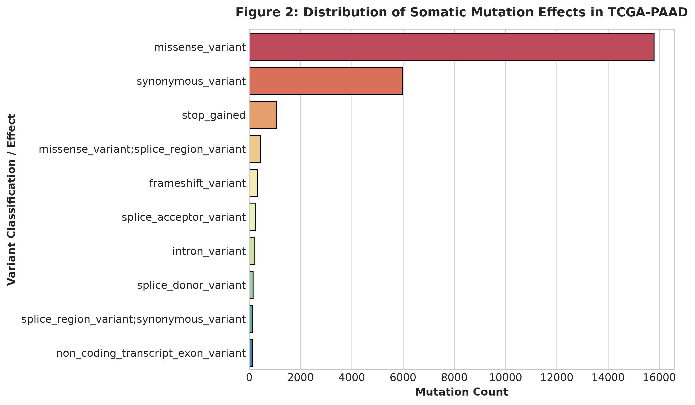
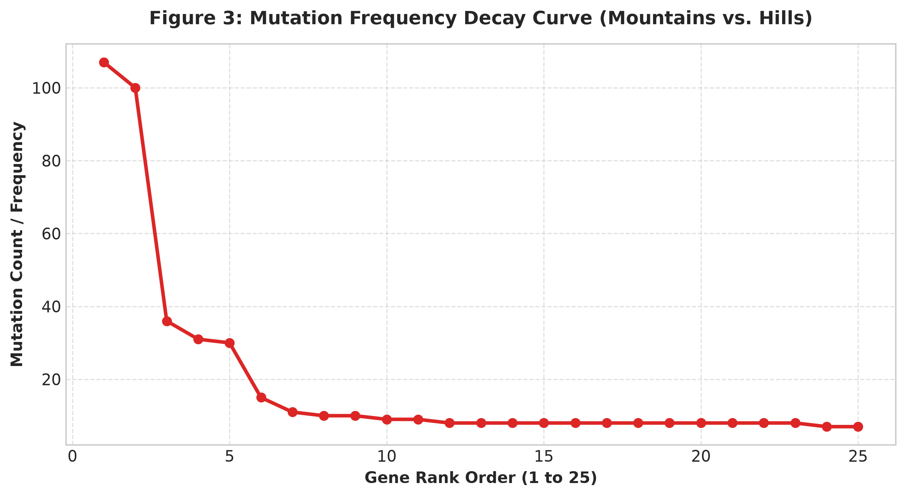
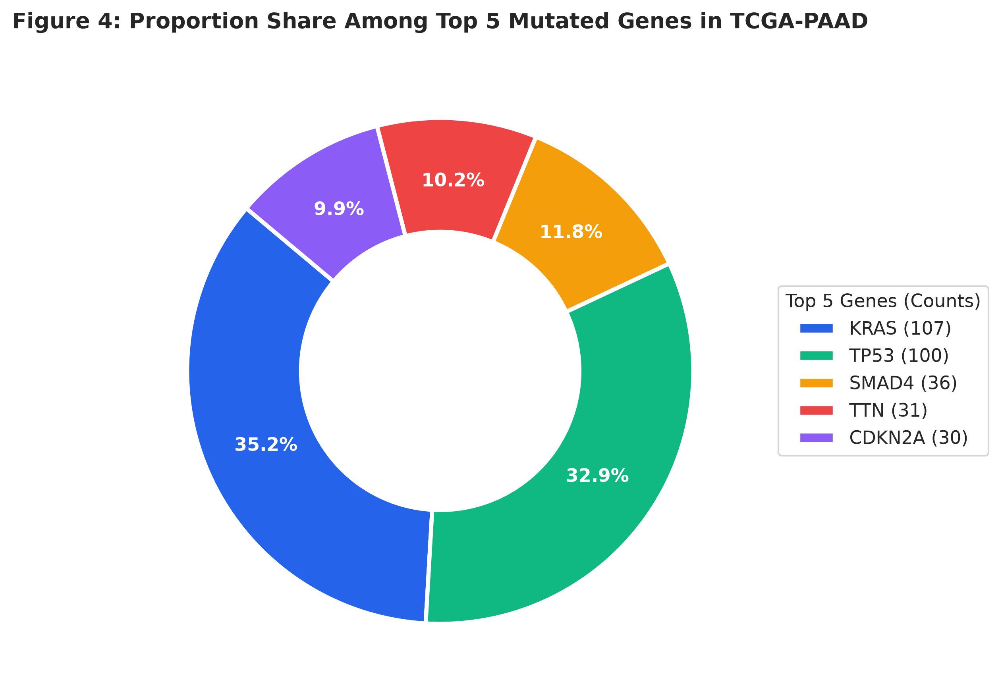

<!-- =====================================================
     HERO
===================================================== -->

<section class="research-hero">

    

        CANCER GENOMICS • BIOINFORMATICS PROJECT
    

    <h1>
        Pancreatic Cancer:
         
        Investigating Its Mutation Landscape
    </h1>

    

        A computational investigation of somatic mutations in
        pancreatic adenocarcinoma using TCGA-PAAD data. By analyzing
        mutation frequencies, variant classifications, and gene-level
        patterns, this project explores the molecular changes that
        characterize pancreatic tumors.
    

</section>

<!-- =====================================================
     RESEARCH QUESTION
===================================================== -->

    

        Central Research Question
    

    <h2>
        Which genes are most frequently mutated in the analyzed
        pancreatic adenocarcinoma tumors, and what can the distribution
        of these mutations tell us about the molecular landscape of
        this cancer?
    </h2>

<!-- =====================================================
     PROJECT OVERVIEW
===================================================== -->

# 1. Why Study Pancreatic Cancer Genetics?

Pancreatic cancer is not a single molecular disease. Tumors can contain
different genetic alterations, and these alterations can influence
how cancer cells grow, survive, interact with their environment, and
respond to treatment.

Understanding the genetic landscape of pancreatic cancer is an
important part of cancer research. Researchers can study tumor DNA
to identify recurring mutations, investigate biological pathways,
and develop hypotheses about which molecular changes may contribute
to cancer development.

One important approach is to examine **somatic mutations**.

Somatic mutations are genetic alterations acquired by cells during
a person's lifetime. Unlike inherited germline variants, somatic
mutations arise in individual cells or tissues and may accumulate
during tumor development.

This project examines somatic mutation data from the
**The Cancer Genome Atlas Pancreatic Adenocarcinoma project
(TCGA-PAAD)**.

The analysis uses Python to identify frequently mutated genes,
categorize mutation effects, and visualize the distribution of
mutation counts.

## What I am investigating

- Which genes have the highest number of observed tumor mutations?
- How are mutation records distributed across variant classifications?
- How quickly do mutation counts decrease from the most frequent
  genes to less frequently mutated genes?
- How concentrated are the counts among the five most frequently
  mutated genes?
- What are the limitations of using mutation frequency to understand
  cancer biology?

---

# 2. Dataset and Research Method

## The Cancer Genome Atlas — TCGA-PAAD

The Cancer Genome Atlas (TCGA) is a large cancer genomics research
program that generated molecular and clinical datasets across
multiple cancer types.

The TCGA-PAAD project focuses on pancreatic adenocarcinoma.

For this project, I used a somatic mutation dataset with the filename:

`TCGA-PAAD.somaticmutation_wxs.tsv`

The `wxs` designation refers to whole-exome sequencing data.
Whole-exome sequencing focuses on the protein-coding portions of
the genome, where many disease-associated mutations occur.

The dataset contains mutation records that can be organized by
gene, tumor sample, and mutation classification.

**Data source:** [NCI Genomic Data Commons](https://portal.gdc.cancer.gov/)

## How the analysis was performed

The analysis was conducted in Python using Jupyter Notebook.

The main libraries included:

- **Pandas:** loading, organizing, and grouping mutation records.
- **NumPy:** numerical operations and color generation.
- **Matplotlib:** creating the figures.
- **Seaborn:** supporting statistical visualization.

The analysis followed four main steps.

    

        
STEP 01

        <h3>Load the data</h3>
        

            Import the TCGA-PAAD somatic mutation file and inspect
            its available gene, sample, and mutation-effect columns.
        

    

    

        
STEP 02

        <h3>Measure gene frequency</h3>
        

            Count the number of unique tumor samples associated
            with mutations in each gene when a sample identifier
            is available.
        

    

    

        
STEP 03

        <h3>Classify mutation records</h3>
        

            Examine the distribution of recorded variant
            classifications or mutation effects.
        

    

    

        
STEP 04

        <h3>Visualize patterns</h3>
        

            Create four figures to compare gene frequencies,
            mutation classifications, rank patterns, and
            the distribution among the top five genes.
        

    

## Important methodological distinction

When a sample identifier is available, the gene-frequency calculation
counts **unique tumor samples per gene**, rather than simply counting
every mutation record.

This matters because one tumor can contain multiple mutation records
for the same gene.

The mutation-effect distribution, however, is calculated using
the number of records in each classification. It should therefore
be interpreted as a distribution of mutation records, not necessarily
a distribution of unique patients.

---

# 3. Figure One — The Most Frequently Mutated Genes

    <picture>
        <source srcset="/figures/fig1_top_mutated_genes.png" type="image/png">
        
    </picture>
    

        <strong>Figure 1.</strong>
        Top 25 most frequently mutated genes in the analyzed
        TCGA-PAAD somatic mutation dataset. The horizontal axis
        represents the number of unique tumor samples with a
        mutation recorded in each gene, when sample identifiers
        are available.
    

## What does this figure show?

This figure ranks the 25 genes with the highest mutation frequencies
in the analyzed dataset.

Each bar represents a gene, and its length represents the number
of tumor samples in which a mutation was recorded for that gene.

The visualization makes it easier to identify genes that appear
frequently across the analyzed tumor samples.

A small number of genes may account for a relatively large number
of observed mutation-positive samples, while other genes may appear
less frequently.

## Why is this important?

Repeated mutations in a gene can make it an important candidate
for further investigation.

However, frequency alone does not establish that a mutation
causes cancer.

A frequently mutated gene may be:

- A driver gene that contributes to tumor development.
- A gene affected by mutations that accumulate without directly
  driving cancer growth.
- A gene with multiple different mutation types and biological
  consequences.

A gene's role must be evaluated using additional evidence, including
the specific mutation, its functional effect, biological context,
and supporting experimental or clinical research.

## Questions raised by the results

- Which gene appears most frequently in this dataset?
- Is there a large difference between the most frequent gene
  and the remaining genes?
- Are the most frequently mutated genes already recognized
  in pancreatic cancer research?
- Which genes would be most interesting to investigate further?

---

# 4. Figure Two — Distribution of Mutation Effects

    <picture>
        <source srcset="/figures/fig2_mutation_effects.png" type="image/png">
        
    </picture>
    

        <strong>Figure 2.</strong>
        Distribution of the ten most frequently recorded
        variant classifications or mutation effects in the
        analyzed TCGA-PAAD dataset.
    

## What are mutation classifications?

A mutation classification describes the type of genetic change
identified in a sequencing result.

Different mutation types can affect genes in different ways.

Examples of common variant classifications include:

| Classification | General description |
|---|---|
| Missense mutation | Changes one amino acid in a protein sequence. |
| Nonsense mutation | Introduces a premature stop codon. |
| Silent mutation | Changes a DNA sequence without changing the encoded amino acid. |
| Frame shift insertion | Inserts bases in a way that changes the reading frame. |
| Frame shift deletion | Removes bases in a way that changes the reading frame. |
| Splice-site mutation | Affects sequences involved in RNA splicing. |
| In-frame insertion | Inserts amino acids without shifting the reading frame. |
| In-frame deletion | Removes amino acids without shifting the reading frame. |

The actual categories in the figure depend on the classifications
present in the downloaded dataset.

## Why do these differences matter?

Not all mutations have the same biological consequences.

For example, a missense mutation may alter a single amino acid
and change protein function. A frameshift mutation may disrupt
a larger portion of the resulting protein.

Some mutations may have little or no functional effect, while
others can interfere with important cellular processes.

This is why identifying the type of mutation is an important
step toward understanding its possible biological significance.

## How to interpret this figure

The figure ranks the most common mutation-effect categories
by the number of records.

It can help answer questions such as:

- Which mutation classifications appear most often?
- Are protein-altering mutation categories prominent?
- How does the distribution compare between different
  classifications?

An important limitation is that the figure counts mutation
records. A single tumor can contribute multiple records, so
the bars should not be interpreted as percentages of patients.

---

# 5. Figure Three — Mutation Frequency Rank Curve

    <picture>
        <source srcset="/figures/fig3_frequency_rank_curve.png" type="image/png">
        
    </picture>
    

        <strong>Figure 3.</strong>
        Mutation-frequency rank curve for the 25 most frequently
        mutated genes. Genes are ordered from highest to lowest
        frequency.
    

## What is a rank curve?

The rank curve organizes genes according to their mutation frequency.

The first position represents the most frequently mutated gene.
The second position represents the next most frequent gene, and
the pattern continues through the 25th gene.

This visualization provides a different perspective from the
bar chart.

Rather than emphasizing individual gene names, it emphasizes
the overall distribution of mutation frequency.

## What can the shape tell us?

A steep decline would indicate that the highest-ranked genes
have substantially more mutation-positive samples than the
genes that follow them.

A more gradual decline would suggest that mutation frequencies
are distributed more evenly across the ranked genes.

This can help identify whether the observed mutation landscape
is concentrated among a relatively small group of genes.

However, a descending rank curve alone does not demonstrate
a mathematical power-law distribution. Establishing that would
require additional statistical modeling.

## Why include this figure?

The first figure answers:

**Which genes are most frequently mutated?**

The rank curve answers:

**How concentrated are the observed mutation frequencies?**

Together, the figures provide complementary ways to examine
the same gene-frequency data.

---

# 6. Figure Four — Distribution Among the Top Five Genes

    <picture>
        <source srcset="/figures/fig4_top_genes_donut.png" type="image/png">
        
    </picture>
    

        <strong>Figure 4.</strong>
        Relative share of the mutation-frequency counts among
        the five most frequently mutated genes in the analyzed
        dataset. The legend identifies each gene and its count.
    

## What does this donut chart represent?

The donut chart takes the five highest-frequency genes and
compares their counts as portions of the combined total for
those five genes.

It provides a compact way to see how the top five genes
compare with one another.

The percentages represent each gene's share of the sum of
the five displayed gene counts.

**They do not represent the percentage of all pancreatic
cancer patients with a mutation.**

The same tumor may contribute to more than one gene's count.
Therefore, these shares should not be interpreted as mutually
exclusive patient groups.

## Why is this useful?

The chart provides another way to compare the leading genes.

It can help identify whether one gene dominates the top-five
group or whether the counts are more evenly distributed.

It also makes it easier to communicate the relative contribution
of each gene to the combined top-five count.

---

# 7. Connecting the Results to Pancreatic Cancer Biology

Mutation-frequency analysis is an introductory way to explore
the molecular landscape of cancer.

The next step is to connect the observed genes to biological
processes.

Pancreatic ductal adenocarcinoma research has identified recurring
genetic alterations involving pathways associated with:

- Cell growth and proliferation.
- Cell-cycle regulation.
- Tumor-suppressor activity.
- DNA damage repair.
- Cellular signaling.
- Differentiation and cell identity.

A well-known genomic study by Bailey and colleagues analyzed
456 pancreatic ductal adenocarcinomas and identified recurrently
mutated genes grouped into several biological pathways.

The study also described molecular subtypes of pancreatic
ductal adenocarcinoma, illustrating that tumors can differ
in their underlying molecular characteristics.

**Reference:** Bailey et al., *Genomic analyses identify molecular
subtypes of pancreatic cancer*, Nature (2016).

[Read the publication](https://www.nature.com/articles/nature16965)

## Frequency is not the same as importance

A common mutation is not automatically the most biologically
important mutation.

For example:

- A less frequent mutation may have a substantial functional
  effect.
- A frequent mutation may not directly contribute to tumor
  growth.
- Different mutations in the same gene may have different
  consequences.
- A mutation's importance may depend on the other alterations
  present in the same tumor.

This is an important distinction when interpreting cancer
genomics data.

The figures in this project are therefore best viewed as a
starting point for identifying genes and patterns that deserve
more detailed investigation.

---

# 8. Limitations of the Analysis

This project provides an exploratory analysis of a specific
somatic mutation dataset. Several limitations should be
considered before drawing broader conclusions.

## 1. Dataset representation

TCGA-PAAD represents a research cohort, not every person
diagnosed with pancreatic cancer.

The observed mutation frequencies should not automatically
be generalized to all pancreatic cancer patients or every
pancreatic cancer subtype.

## 2. Mutation frequency does not prove causation

A mutation occurring frequently does not prove that it
caused the cancer.

Additional functional and clinical evidence is needed to
determine whether a mutation contributes to tumor development.

## 3. Mutation records are not always unique patients

The gene-frequency calculation uses unique sample identifiers
when the dataset contains a recognized sample column.

The mutation-effect chart counts individual records.
Consequently, one tumor may contribute multiple records.

## 4. Whole-exome sequencing has limitations

Whole-exome sequencing focuses on protein-coding regions
rather than examining every part of the genome.

Some genetic alterations outside the regions captured by
the sequencing approach may not be represented.

## 5. Mutation classification is not a complete functional analysis

A classification such as missense or frameshift describes
the type of sequence alteration.

It does not, by itself, establish the exact effect on protein
function or clinical behavior.

## 6. The analysis is descriptive

This project identifies and visualizes patterns.

It does not perform a complete driver-gene analysis, survival
analysis, pathway enrichment analysis, or clinical actionability
assessment.

These would be valuable directions for future research.

---

# 9. Future Research Directions

The mutation-frequency analysis provides a foundation for
more advanced computational biology projects.

Several additional analyses could expand this work.

    

        
NEXT PROJECT 01

        <h3>Investigate individual genes</h3>
        

            Examine the specific mutations found in frequently
            mutated genes and investigate their potential
            functional consequences.
        

    

    

        
NEXT PROJECT 02

        <h3>Mutation co-occurrence</h3>
        

            Determine whether certain genetic alterations tend
            to appear together in the same tumor samples.
        

    

    

        
NEXT PROJECT 03

        <h3>Pathway enrichment</h3>
        

            Investigate whether the frequently mutated genes
            are associated with particular biological pathways.
        

    

    

        
NEXT PROJECT 04

        <h3>Clinical data integration</h3>
        

            Explore whether molecular alterations are associated
            with clinical characteristics or patient outcomes,
            where suitable data and analysis methods are available.
        

    

## A possible next question

One particularly interesting direction is to investigate
whether the most frequently mutated genes are also associated
with specific clinical outcomes.

This would require combining genomic data with appropriately
matched clinical information and applying suitable statistical
methods.

It would move the project beyond describing which mutations
are present and toward investigating how molecular differences
may relate to disease behavior.

---

# 10. Conclusion

This project uses TCGA-PAAD somatic mutation data to explore
the genetic landscape of pancreatic adenocarcinoma.

By analyzing gene-level mutation frequencies, variant
classifications, and the distribution of mutation counts,
the project provides an introductory look at how computational
methods can be used to investigate cancer biology.

The four visualizations approach the data from different
perspectives:

1. The top-gene bar chart identifies the most frequently
   mutated genes in the analyzed samples.
2. The mutation-effect chart examines the types of recorded
   variant classifications.
3. The rank curve illustrates how mutation frequencies
   change across the highest-ranked genes.
4. The donut chart compares the relative counts of the
   five most frequently mutated genes.

The most important takeaway is that mutation frequency is
only one part of understanding cancer genetics.

To understand why a mutation matters, researchers must
investigate its biological function, the pathways it affects,
its relationship with other mutations, and its potential
clinical significance.

Computational analysis provides a way to identify patterns
and generate questions that can guide that deeper research.

    <h2>From mutation data to biological understanding</h2>

    

        The goal of this project is not simply to identify
        the most frequently mutated genes. It is to use
        genomic data as a starting point for understanding
        the biological processes involved in pancreatic
        cancer and the research questions that remain.
    

---

# Data, Sources, and Methodology

## Primary data source

**National Cancer Institute — Genomic Data Commons**

The Genomic Data Commons provides access to cancer genomic
datasets, including data from The Cancer Genome Atlas.

[https://portal.gdc.cancer.gov/](https://portal.gdc.cancer.gov/)

**Project:** TCGA-PAAD — Pancreatic Adenocarcinoma

**Dataset analyzed:** `TCGA-PAAD.somaticmutation_wxs.tsv`

The exact download manifest, file UUID, data release, and
workflow metadata should be retained with the project files
to make the analysis reproducible.

## Scientific background

Bailey, P. et al. (2016).

*Genomic analyses identify molecular subtypes of pancreatic cancer.*

Nature, 531, 47–52.

[https://www.nature.com/articles/nature16965](https://www.nature.com/articles/nature16965)

Waddell, N. et al. (2015).

*Whole genomes redefine the mutational landscape of pancreatic cancer.*

Nature, 518, 495–501.

[https://www.nature.com/articles/nature14169](https://www.nature.com/articles/nature14169)

## Analysis tools

- Python
- Jupyter Notebook
- Pandas
- NumPy
- Matplotlib
- Seaborn

## Reproducibility and interpretation

The figures in this article were generated using Python
and the TCGA-PAAD somatic mutation dataset.

The code and dataset should be retained alongside the
research project so that the analysis can be repeated
and independently checked.

The results describe the analyzed dataset and should not
be interpreted as population-wide estimates or clinical
recommendations.

---

# Artificial Intelligence Use

Artificial intelligence tools were used to assist with
organizing the project, developing and troubleshooting
website code, improving the presentation of the research,
and structuring the explanations accompanying the figures.

AI was not used as a substitute for the original genomic
data or scientific publications.

The data analysis was performed using Python, and the
interpretation of the figures should be checked against
the underlying dataset and cited scientific literature.

The author is responsible for reviewing the analysis,
verifying factual claims, and evaluating the conclusions
presented in this project.

---

# Source and Citation Statement

This project uses publicly available cancer genomic data
and scientific publications.

Information from external sources has been summarized
in the author's own words unless otherwise indicated.

All graphs were generated by the author using Python
and the downloaded research dataset.

The visualizations represent the results of the analysis
rather than reproductions of figures from the cited
publications.

---

**© 2026 Parthiv Varma Nandigam • GitHub • LinkedIn**